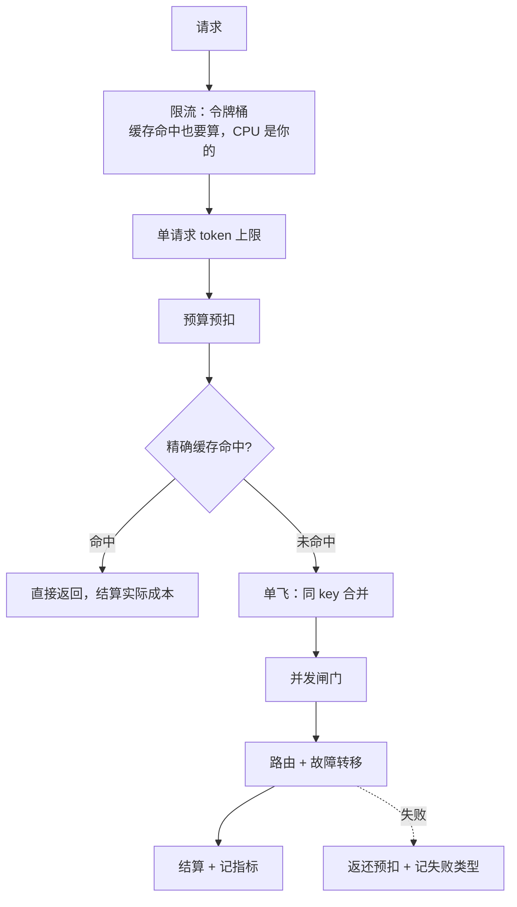
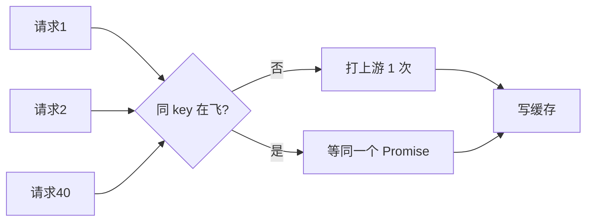

# agent-gateway

> **LLM 网关 + React 控制台**：多 provider 路由与故障转移、令牌桶限流、并发闸门、单飞 + 精确缓存、预算熔断、SSE 流式透传、Prometheus 指标。

后端零运行时依赖（Node 内置 http/fetch）；前端 React 18 + Vite + TypeScript。

---

## 一、这个项目解决什么问题

把 LLM 直接接进业务，会在第一个人流量上来时集体爆掉：

| 直连的问题 | 网关怎么解 |
|---|---|
| 上游限流 → 你的服务跟着 500 | 令牌桶限流 + 并发闸门 + 熔断快速失败 |
| 一个 provider 挂了 → 全站不可用 | 加权路由 + 故障转移 + 三态熔断 |
| 账单月末爆炸，不知道谁用的 | 租户预算预扣 + 按租户归因 |
| 相同问题重复计费 | 精确缓存 + 单飞合并 |
| 客户抱怨「等太久才出字」 | SSE 透传 + TTFT 分层度量 |
| 出问题只能看日志猜 | Prometheus 指标 + 控制台实时看板 |

---

## 二、能重点学到什么

| 能力 | 落点 |
|---|---|
| 过载保护三件套 | 令牌桶（速率）× 并发闸门（同时在飞）× 熔断（上游挂了快速失败） |
| 故障转移的边界 | 只在「未吐内容前」转移；调用方错误（400）不重试也不记 provider 故障 |
| 缓存击穿 | 40 并发相同请求 → 上游只打 1 次（单飞），实测 p50 从 98ms → 22ms |
| 预算并发超支 | 请求前**预扣**、响应后结算，关掉「同时通过检查」的窗口 |
| SSE 真透传 | 客户端断开即中止上游，避免继续计费 |
| 前后端一体 | React 控制台直连自己的 API 做真实调用，不是假数据 demo |

---

## 三、能应对什么样的提问

**「上游挂了怎么办？」**
> 三态熔断：连续 5 次上游失败开闸，冷却 30 秒后进入 half-open 只放 1 个探测，成功恢复、失败重开。压测实测：上游全挂时 p50 从「等超时」降到 1.7ms。而且只把 429/5xx/网络错算作上游故障，400 参数错不算——否则用户传错参数能把 provider 熔断掉。

**「怎么防止某个租户把额度用光？」**
> 请求前按「输入估算 + max_tokens」预扣，响应后按真实 usage 结算。只做「事后检查」的话，并发 N 个请求会同时通过检查然后一起超额；预扣把这个窗口关掉了。

**「缓存会不会返回错误答案？」**
> 只做精确缓存，不做语义缓存。语义缓存在订单场景是危险的——A1001 问「到哪了」和 A1002 问「到哪了」语义相同但答案不同。key 里带 model/system/messages/max_tokens 全字段；temperature>0、流式、带工具调用的请求默认不缓存。

**「缓存击穿怎么处理？」**
> 单飞。压测抓出来的真实问题：40 个相同请求同时到达，缓存全部未命中，上游被打了 40 次。加了 single-flight 后上游只打 1 次，其余 39 个等结果。p50 从 98ms 降到 22ms。

**「流式怎么做？」**
> 真 SSE 透传，边收边发。两个细节：客户端断开要 abort 上游（否则继续计费）；`x-accel-buffering: no` 防止 nginx 缓冲把流式变成一次性。TTFT 单独统计，和总延迟分开看。

**「前后端怎么配合的？」**
> 控制台是 React + Vite + TS，直连网关自己的 API：KPI 卡片读 `/metrics`、熔断状态和租户用量读 `/health` 与 `/api/usage`、调试台直接 POST `/v1/chat/completions` 并处理 SSE。构建产物由 node 服务静态托管，Docker 多阶段构建。

---

## 四、核心原理

### 4.1 请求处理顺序（顺序本身是设计）



**为什么限流在缓存前面**：缓存命中也要消耗你的 CPU 和连接。如果先查缓存再限流，刷缓存就能绕过限流。

### 4.2 熔断三态

```
closed ──连续失败≥阈值──> open ──冷却 30s──> half-open
   ↑                                          │
   └────────── 探测成功 ──────────────────────┘
                    探测失败 → open（冷却重算）
```

half-open 只放 **1 个** 探测请求。放多了等于没熔断。

### 4.3 预算预扣

```
预扣 = cost(输入估算 + max_tokens)     ← 最坏情况
结算 = cost(真实 input + 真实 output)  ← 返还差额
```

用预扣而不是事后检查，是为了关掉「并发请求同时通过检查」的超支窗口。

### 4.4 单飞（single-flight）



---

## 五、技术栈

| 层 | 选择 | 理由 |
|---|---|---|
| 后端运行时 | Node.js ≥ 20 | 内置 fetch / http |
| 后端依赖 | **0 个** | 网关是纯编排逻辑，引框架只增加不可控因素 |
| 前端 | React 18 + Vite 5 + TypeScript | 组件化、类型安全、构建快 |
| 前端状态 | React Hooks（无状态库） | 单一页面、数据来自轮询，不需要 Redux/Zustand |
| 图表 | 手写 SVG | 只画两条折线，引图表库不划算 |
| 容器 | 多阶段（web 构建 → 运行） | 运行镜像里不含 node_modules |
| 测试 | `node --test` + Playwright | API 层 + 浏览器端到端 |

**为什么不用 Next.js**：这是纯客户端看板，没有 SEO、没有 SSR、没有服务端数据依赖。Next 的收益为零，成本是多一套运行时和镜像。

---

## 六、快速开始

```bash
git clone https://github.com/rnnhean/agent-gateway.git
cd agent-gateway

# 后端
npm test                 # 41 个测试
npm run bench            # 压测：限流/闸门/熔断/缓存/单飞 8 项判定

# 前端
cd web && npm install && npm run build && cd ..
node src/server.mjs      # 打开 http://localhost:8794
```

### 环境变量

`env.example` 里是全套。最小可用只需要：

```
LLM_BASE_URL=...   LLM_API_KEY=...   LLM_MODEL=...
```

可选：`THINKING_MODE=disabled` 关掉思考块（省 token 但可能降低质量，见下）。

---

## 七、部署

```bash
docker build -t agent-gateway .
docker run -p 8794:8794 --env-file env.example agent-gateway
```

多阶段构建：阶段 1 用 Vite 构建 React，阶段 2 只带 `src/` 和构建产物，非 root 运行，带健康检查。

| 路由 | 说明 |
|---|---|
| `GET /` | React 控制台 |
| `GET /health` | 健康 + 熔断/闸门/缓存统计 |
| `GET /metrics` | Prometheus |
| `GET /api/usage` | 租户用量 |
| `POST /v1/chat/completions` | OpenAI 兼容（支持 `stream: true`） |

---

## 八、监控

| 指标 | 用来回答 |
|---|---|
| `gateway_requests_total` | 流量 |
| `gateway_outcome_total{outcome}` | 失败原因分布：rate_limited / budget_exceeded / upstream_error / cache_hit / coalesced |
| `gateway_tenant_errors_total{tenant}` | 哪个租户在报错 |
| `gateway_latency_ms{quantile}` | p50/p95/p99 |
| `gateway_ttft_ms{quantile}` | 流式首字时间 |

---

## 九、实测数据

### 压测（假 provider，衡量网关自身）

| 场景 | 请求数 | rps | p50 | p95 | 上游峰值并发 | 结果分布 |
|---|---:|---:|---:|---:|---:|---|
| 基线（无限流） | 200 | 1673 | 68ms | 100ms | 32 | ok 200 |
| 限流 20 容量 / 50rps | 200 | 12212 | 0ms | 16ms | 20 | ok 20 + 拒绝 180 |
| 闸门=4 上游 100ms | 40 | 37 | 656ms | 1084ms | **4** | ok 40 |
| 熔断（上游全挂） | 60 | 27946 | **1.7ms** | 1.8ms | 32 | 失败 32 + 快速拒绝 28 |
| 故障转移 | 40 | 507 | 47ms | 79ms | 8 | ok 40 |
| 缓存（40 并发同请求） | 40 | 1653 | 22ms | 23ms | **1** | 上游 1 次 + 合并 39 |

8 项判定全部通过。

### 真实模型 + 浏览器

Playwright 无头实测：页面加载 → KPI/图表/表格渲染 → 调试台发真实请求 → 收到「北京」，首字 1524ms，总 1748ms。12/12 通过，截图见 `results/`。

---

## 十、局限（说实话）

1. **无鉴权**，靠 `x-tenant` 头识别租户，内网 sidecar 定位。
2. **单机限流与预算**，多实例需要共享存储（Redis）。
3. **缓存是精确匹配**，改一个字就不命中；语义缓存要额外解决「上下文实体不同」的问题。
4. **只实现了 Anthropic 与 OpenAI 兼容两种协议**，其他厂商需加 adapter。
5. **思考块策略需按模型调**：实测关闭思考能省 token，但在需要推理的问题上质量会掉——所以默认不干预。

---

## 十一、许可

MIT
